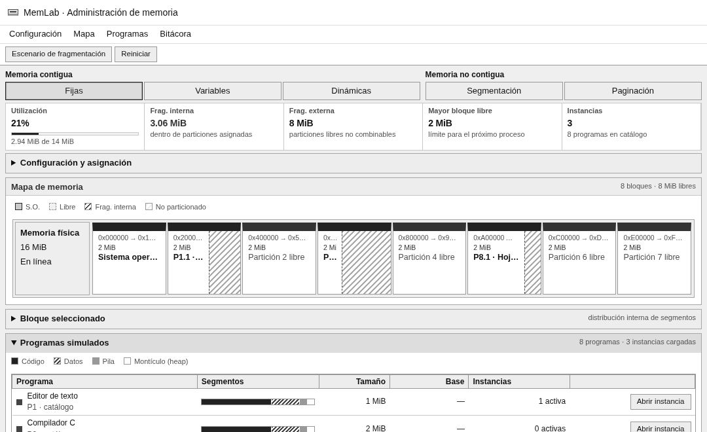

# MemLab · Simulador de memoria

Explora cómo un sistema operativo reparte **16 MiB de memoria**. Carga programas, observa dónde se ubican y libera instancias para ver cómo aparecen huecos. La interfaz toma como referencia las consolas clásicas de Windows y pone el mapa físico en primer plano.

[Inicio rápido](#inicio-rápido) · [Manual de usuario](entregables/manual_usuario.pdf) · [Manual técnico](entregables/manual_tecnico.pdf) · [Informe final](entregables/informe_final.pdf)

## Vista previa

Mapa de memoria y catálogo tras cargar el escenario de fragmentación. Haz clic en la captura para ampliarla.

## Inicio rápido

1. Clona o descarga el repositorio y abre `index.html` en el navegador. Usa HTML, CSS y JavaScript, sin instalación ni compilación.
2. Escoge un modo y abre **Configuración y asignación** si quieres ajustar sus parámetros.
3. Carga una instancia en **Programas simulados** o ejecuta el escenario de la barra de acciones.
4. Selecciona un bloque en el mapa y abre **Bloque seleccionado** para consultar sus direcciones. La **Bitácora** explica cada asignación, liberación y rechazo.

## Modos de simulación

| Modo | Qué puedes observar |
| --- | --- |
| Fijas | Particiones del mismo tamaño y espacio perdido dentro de cada asignación. |
| Variables | Particiones predefinidas de tamaños distintos y el efecto del algoritmo de ajuste. |
| Dinámicas | Huecos según el tamaño de cada programa y el efecto de la compactación. |
| Segmentación | Partes de un programa en direcciones físicas separadas. |
| Paginación | Páginas lógicas en marcos físicos y traducción de direcciones. |

Ver las reglas de asignación en detalle

## Cómo funcionan los cinco modos

El sistema modela 16 MiB de memoria física, de los cuales una porción
inicial (configurable: 1, 2 o 4 MiB) está reservada para el sistema
operativo. El resto ("memoria de usuario") se gestiona con uno de cinco
métodos, agrupados en memoria contigua y no contigua:

### 1 · Particiones estáticas de tamaño fijo
Indicas el tamaño de cada partición en KiB; el simulador crea tantas
particiones iguales como quepan en la memoria de usuario. El sobrante
queda sin particionar. Un programa se carga en la primera partición
libre que le quepa. Si el programa es más pequeño que la partición,
el espacio sobrante es **fragmentación interna** (se pierde: nadie más
puede usarlo mientras esa partición esté ocupada).

### 2 · Particiones estáticas de tamaño variable
Igual que el método 1, pero con una tabla de particiones de tamaños
distintos que tú defines (añadiendo o quitando entradas en KiB). Aquí
sí aplica el algoritmo de ajuste:

- **Primer ajuste**: la primera partición libre donde el programa quepa.
- **Mejor ajuste**: la partición libre más pequeña que aún así le quepa
  (minimiza el desperdicio de esa asignación, pero puede dejar particiones
  pequeñas inutilizables a la larga).
- **Peor ajuste**: la partición libre más grande (deja restos más
  grandes, potencialmente más reutilizables después).

### 3 · Particiones dinámicas
No hay particiones predefinidas: se crean "huecos" a medida que los
programas se cargan y liberan, del tamaño exacto que cada uno necesita.
Por eso **no hay fragmentación interna** en este método. En cambio, con
el tiempo aparece **fragmentación externa**: memoria libre de sobra,
pero repartida en huecos pequeños y no contiguos, insuficiente para
admitir un programa grande aunque la suma total alcance.

Para resolverlo existe la **compactación**: reubica todos los procesos
cargados de forma contigua, dejando toda la memoria libre unida en un
solo bloque al final. Puede lanzarse manualmente o activarse en modo
automático (se dispara sola cuando un programa es rechazado por falta
de espacio contiguo, pero sí hay espacio total suficiente).

### 4 · Segmentación (memoria no contigua)

Cada programa se representa mediante seis segmentos lógicos numerados
desde 0: `.text`, `.rodata`, `.data`, `.bss`, `.stack` y `.heap`. Los cuatro
primeros son nombres habituales de secciones de un ejecutable; pila y
heap son regiones de memoria durante la ejecución. En el simulador las
seis son unidades asignables para mostrar la traducción lógica a física.

Al cargar un programa, cada segmento se asigna por **mejor ajuste** al
hueco libre más pequeño en el que cabe. Si falla cualquiera de los seis,
no se asigna ninguno. Cada clic en **Abrir instancia** intenta cargar una
copia independiente del programa. Las copias se nombran en secuencia
(por ejemplo, `Hoja de cálculo 1` y `Hoja de cálculo 2`) y cada una tiene
su propio botón **Eliminar**. Selecciona una instancia para ver sus seis
partes y su tabla de segmentación (número lógico, base física y tamaño).
El mapa resalta a la vez todos los bloques de esa instancia, aunque estén
separados. Al eliminarla se devuelven solo sus segmentos y se fusionan
los huecos adyacentes; las demás copias permanecen cargadas.

Los programas de ejemplo conservan sus tamaños originales: código se
desglosa en `.text` y `.rodata`, y datos en `.data` y `.bss`. Al añadir un
programa en segmentación puedes definir directamente los seis tamaños.

### 5 · Paginación (memoria no contigua)

La RAM se divide en marcos físicos de 32, 64, 128 o 256 KiB. El tamaño
predeterminado es **64 KiB**: 16 MiB dan 256 marcos. Con 1 MiB para el
S.O., 16 marcos quedan reservados y 240 disponibles. La reserva también
puede ser de 2 o 4 MiB. Cambiar el tamaño de página o la reserva
reconstruye la memoria y cierra las instancias activas.

Cada instancia tiene su propia tabla de páginas. Se reutilizan las seis
regiones de segmentación: `.text`, `.rodata`, `.data`, `.bss`, `.stack` y
`.heap`. **Decisión del modelo educativo:** cada región empieza en un
límite de página, de modo que una página corresponde a una sola región.
Para una región de `S` bytes se crean `ceil(S / P)` páginas, donde `P` es
el tamaño de página. La última puede tener relleno. La numeración de
páginas es consecutiva dentro de la instancia y comienza en cero.

La asignación usa **primer marco libre** en orden de dirección física.
Antes de ocupar ningún marco se comprueba que quepan todas las páginas;
si faltan marcos, se rechaza la carga completa. No hay memoria secundaria,
paginación por demanda ni reemplazo: toda página de una instancia cargada
está presente. Al eliminarla se liberan únicamente sus marcos. Los marcos
de distintas instancias pueden intercalarse; no se necesita compactación.

La tabla global muestra número, base física, estado, instancia propietaria
y página lógica de cada marco. Al seleccionar una instancia se resaltan
sus marcos y aparecen su tabla de páginas, páginas requeridas, memoria
lógica utilizada, memoria física asignada y fragmentación interna. Esta
última es la suma de `ceil(S_i / P) × P − S_i` para las seis regiones.
La utilización usa memoria física asignada dividida por RAM de usuario
(`16 MiB − reserva del S.O.`). No se reporta fragmentación externa para
este método, porque cualquier marco libre puede usarse.

El traductor admite direcciones lógicas decimales o hexadecimales con
prefijo `0x`. Calcula `p = floor(D / P)` y `d = D mod P`, consulta la tabla
de páginas de la instancia y obtiene la dirección física `marco × P + d`.
La dirección lógica se interpreta en el espacio paginado con alineaciones
entre regiones. Se rechazan las direcciones fuera de ese espacio y los
bytes de relleno de las últimas páginas.

El **Escenario de paginación** carga varias instancias, elimina una
intermedia y carga otra más grande. Esta reutiliza los marcos liberados y
continúa después de una instancia que sigue activa, mostrando páginas
físicamente separadas. El catálogo se conserva y las operaciones quedan
en la bitácora.

## Estructura

| Archivo | Responsabilidad |
| --- | --- |
| `index.html` | Controles y paneles del simulador. |
| `css/style.css` y `css/desktop.css` | Distribución y estilo de consola. |
| `js/script.js` | Algoritmos de asignación, mapa y bitácora. |
| `entregables/` | Manuales e informe académico. |

## Licencia

Distribuido bajo la [licencia MIT](LICENSE).
